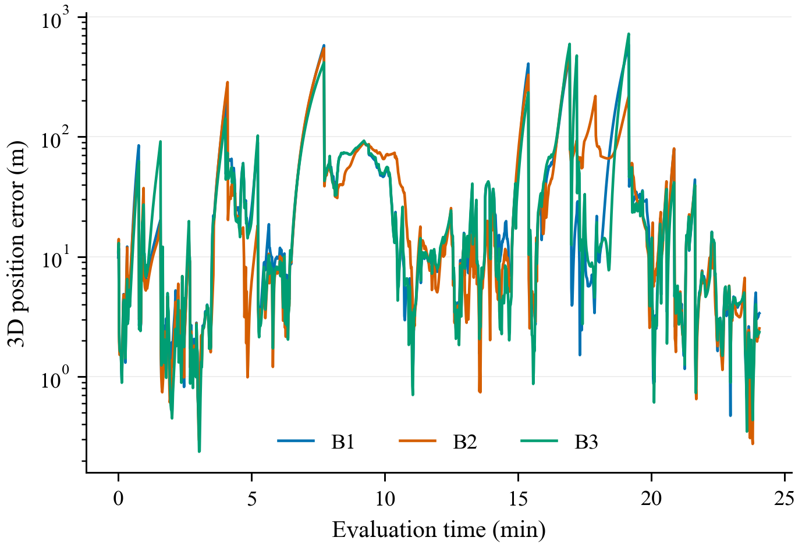
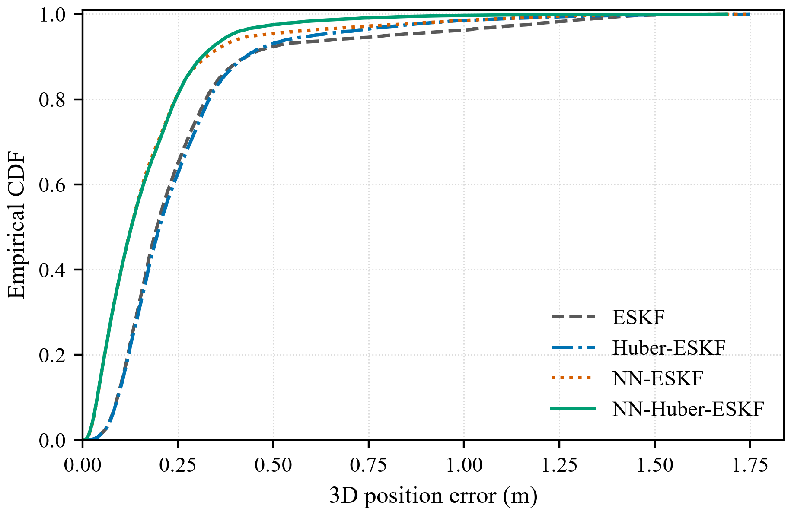
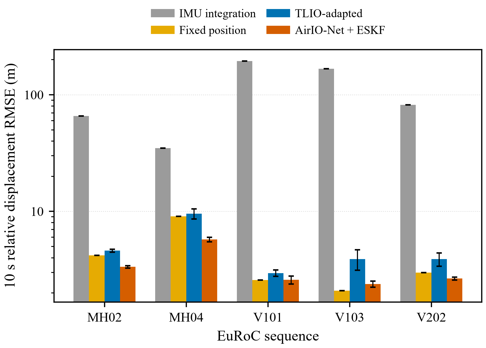

# UAV positioning experiments for Chapter 3

This project contains reproducible positioning experiments for Sections 3.4 and 3.5.
B1 to B3 compare GNSS/IMU estimators on two UrbanNav ground-vehicle sequences.
LC, TC-Pose and TC-Surface compare three GLIO-based configurations on Deep-Urban-1.
Each group has its own shared inputs, initialization and evaluation protocol.
Do not combine the two groups into one six-method accuracy ranking.
The UrbanNav studies use a ground vehicle. UTIL provides recorded UAV flights, but
this repository does not establish onboard real-time performance. The Section 3.4
methods require no trained weights.

## Algorithm map and trade-offs

<table role="presentation" width="100%">
<tr>
<td width="50%" valign="top">
<h3>Sections 3.4.1-3.4.5: Conventional GNSS/IMU estimation</h3>
<table>
<tr><th>Method and section</th><th>Key trade-off</th></tr>
<tr><td><b>B1</b><br><small>3.4.1 and 3.4.2<br>GNSS/IMU error-state Kalman filter (ESKF)</small></td><td><small><b>Advantage:</b> Simple causal baseline.<br><b>Limitation:</b> Sensitive to model errors and bad fixes.</small></td></tr>
<tr><td><b>B2</b><br><small>3.4.3<br>B1 with normalized innovation squared (NIS) rejection</small></td><td><small><b>Advantage:</b> Rejects isolated inconsistent fixes.<br><b>Limitation:</b> May reject useful fixes after drift.</small></td></tr>
<tr><td><b>B3</b><br><small>3.4.1, 3.4.4 and 3.4.5<br>Fixed-lag factor graph with IMU preintegration</small></td><td><small><b>Advantage:</b> Uses temporal constraints in a window.<br><b>Limitation:</b> More computation; no robust GNSS loss here.</small></td></tr>
</table>
</td>
<td width="50%" valign="top">
<h3>Section 3.4.6: GLIO fusion configurations</h3>
<table>
<tr><th>Method and section</th><th>Key trade-off</th></tr>
<tr><td><b>LC</b><br><small>3.4.6<br>GNSS position factors with LiDAR/IMU odometry</small></td><td><small><b>Advantage:</b> Simple position-level interface.<br><b>Limitation:</b> Depends on the quality and availability of position fixes.</small></td></tr>
<tr><td><b>TC-Pose</b><br><small>3.4.6<br>Double-difference pseudorange with relative-pose constraints</small></td><td><small><b>Advantage:</b> Uses raw GNSS structure more directly.<br><b>Limitation:</b> More nonlinear and initialization-sensitive.</small></td></tr>
<tr><td><b>TC-Surface</b><br><small>3.4.6<br>Double-difference pseudorange with LiDAR surface constraints</small></td><td><small><b>Advantage:</b> Adds scene geometry to the tight coupling.<br><b>Limitation:</b> Highest resource cost; depends on scene geometry.</small></td></tr>
</table>
</td>
</tr>
<tr>
<td width="50%" valign="top">
<h3>Section 3.5.2: Learning-aided GNSS</h3>
<table>
<tr><th>Method and section</th><th>Key trade-off</th></tr>
<tr><td><b>WLS</b><br><small>3.5.2<br>Weighted least squares with fixed measurement weights</small></td><td><small><b>Advantage:</b> Training-free and transparent.<br><b>Limitation:</b> Fixed weights do not adapt well to multipath.</small></td></tr>
<tr><td><b>TDL-W</b><br><small>3.5.2<br>Learned satellite weights</small></td><td><small><b>Advantage:</b> Adapts measurement reliability.<br><b>Limitation:</b> No explicit bias correction; needs representative training.</small></td></tr>
<tr><td><b>TDL-B</b><br><small>3.5.2<br>Learned pseudorange bias correction</small></td><td><small><b>Advantage:</b> Corrects repeatable measurement bias.<br><b>Limitation:</b> Does not learn measurement weights.</small></td></tr>
<tr><td><b>TDL-BW</b><br><small>3.5.2<br>Joint learned bias and weight prediction</small></td><td><small><b>Advantage:</b> Combines the two correction mechanisms.<br><b>Limitation:</b> More model dependence and training cost.</small></td></tr>
</table>
</td>
<td width="50%" valign="top">
<h3>Sections 3.5.3, 3.5.5 and 3.5.6: UWB/inertial fusion</h3>
<table>
<tr><th>Method and section</th><th>Key trade-off</th></tr>
<tr><td><b>ESKF</b><br><small>3.5.6<br>Fixed-noise UWB/IMU filter</small></td><td><small><b>Advantage:</b> Simple training-free baseline.<br><b>Limitation:</b> Sensitive to biased time-difference-of-arrival measurements.</small></td></tr>
<tr><td><b>Huber-ESKF</b><br><small>3.5.5 and 3.5.6<br>Robust Huber measurement update</small></td><td><small><b>Advantage:</b> Reduces the influence of large residuals.<br><b>Limitation:</b> A fixed threshold cannot learn systematic bias.</small></td></tr>
<tr><td><b>NN-ESKF</b><br><small>3.5.3, 3.5.5 and 3.5.6<br>Learned UWB bias correction before filtering</small></td><td><small><b>Advantage:</b> Corrects repeatable data-driven bias.<br><b>Limitation:</b> Needs training; no direct NLOS label is evaluated.</small></td></tr>
<tr><td><b>NN-Huber-ESKF</b><br><small>3.5.3, 3.5.5 and 3.5.6<br>Learned correction with a robust update</small></td><td><small><b>Advantage:</b> Combines bias correction and residual robustness.<br><b>Limitation:</b> Most complex and dataset-dependent.</small></td></tr>
</table>
</td>
</tr>
<tr>
<td colspan="2" valign="top">
<h3>Section 3.5.4: Deep inertial odometry</h3>
<table>
<tr><th>Method and section</th><th>Main idea</th><th>Main advantage</th><th>Main limitation</th></tr>
<tr><td><b>IMU integration</b><br><small>3.5.4</small></td><td><small>Direct inertial propagation</small></td><td><small>Training-free reference baseline</small></td><td><small>Accumulated drift grows rapidly</small></td></tr>
<tr><td><b>Fixed position</b><br><small>3.5.4</small></td><td><small>Stationary prediction control</small></td><td><small>Exposes metric and data-split limitations</small></td><td><small>Not a navigation estimator; ignores motion</small></td></tr>
<tr><td><b>TLIO-adapted</b><br><small>3.5.4</small></td><td><small>Learned motion with a stochastic-cloning ESKF</small></td><td><small>Greatly reduces free-integration drift</small></td><td><small>Higher absolute error than the fixed control on this split</small></td></tr>
<tr><td><b>AirIO-Net + ESKF</b><br><small>3.5.4</small></td><td><small>Learned velocity aiding in an ESKF</small></td><td><small>Best tested relative-displacement result</small></td><td><small>Needs training; onboard timing and covariance calibration are unverified</small></td></tr>
</table>
</td>
</tr>
</table>

Section 3.5.1 defines the learning-aided taxonomy used by the Section 3.5 rows;
the implemented comparisons are reported in Sections 3.5.2-3.5.6.

Book section numbers are used here. Some Word drafts display 1.4 instead of 3.4.
See [the section index](chapters/README.md) for current and planned sections.
Section 3.5 contains learning-aided experiments. No Section 3.6 experiment is included.

## Public datasets and fixed splits

| Experiment | Public dataset | Use in this repository |
|---|---|---|
| B1 to B3 | [UrbanNav](https://github.com/IPNL-POLYU/UrbanNavDataset) | Deep-Urban-1 and Medium-Urban-1 evaluation with GNSS, IMU and reference trajectories |
| GLIO | [UrbanNav](https://github.com/IPNL-POLYU/UrbanNavDataset) | Deep-Urban-1 evaluation with GNSS, IMU, LiDAR and the same reference source |
| Learning-aided GNSS | [KLT](https://github.com/ebhrz/KLTDataset) and [UrbanNav](https://github.com/IPNL-POLYU/UrbanNavDataset) | KLT1_203 and KLT2_209 train, KLT3_404 validates, and Deep-Urban-1 tests the models |
| UWB/inertial fusion | [UTIL](https://utiasdsl.github.io/util-uwb-dataset/) | Constellations 1-2 train, constellation 3 validates, and nine constellation-4 flights test the models using IMU and TDoA2 measurements |
| Inertial odometry | [EuRoC MAV](https://projects.asl.ethz.ch/datasets/euroc-mav/) | Five sequences train, one validates, and five test the models using IMU and reference states only |

Raw datasets are not stored in this repository. Exact files, sequence lists and
download steps are in the [Section 3.4 data guide](datasets/README.md) and the
[Section 3.5 data guides](datasets/LearningAid/README.md).

## Run B1 to B3

The prepared environment is `C:\UAV_Chapter3\.envs\b123`. It leaves the existing Conda environments unchanged. From PowerShell:

```powershell
Set-Location C:\UAV_Chapter3\IET_Chapter_3
.\run_benchmark.ps1
```

If PowerShell blocks local scripts, run Python directly without changing the execution policy:

```powershell
& C:\UAV_Chapter3\.envs\b123\python.exe C:\UAV_Chapter3\IET_Chapter_3\run.py all
```

Run one method, regenerate figures, or run the physics checks:

```powershell
.\run_benchmark.ps1 -Action run -Sequence Deep-Urban-1 -Method B1_ESKF
.\run_benchmark.ps1 -Action plot
.\run_benchmark.ps1 -Action test
```

After a single-method rerun, use `-Action summarize` and `-Action plot` to update the tables and figures. A short check is available through `python run.py run --sequence Deep-Urban-1 --method B1_ESKF --max-seconds 60`; short outputs are kept separately under `results/smoke` and never enter the final metrics.

To recreate the Windows environment, use Conda from Anaconda Prompt:

```text
conda create --prefix C:\UAV_Chapter3\.envs\b123 --file C:\UAV_Chapter3\IET_Chapter_3\environment-win-64.lock.txt
```

Alternatively, use `conda env create --prefix C:\UAV_Chapter3\.envs\b123 --file environment.yml`. The lock file pins the tested Windows binaries; the YAML lists the main dependencies. On a fresh checkout, run `python run.py install-rtklib` in that environment to obtain the pinned external frontend files. Internet access is needed only to install dependencies or download the data and RTKLIB, not to run the prepared benchmark. Both setup steps have already been completed on this machine.


## GLIO code and runs

The original upstream revision is `332d19ff641f2ada9d9d75f2a6dab013d6015f76`. The exact estimator changes are
in [source.patch](algorithms/GLIO/source.patch). The local working project may
contain a Git submodule at `algorithms/GLIO/upstream`. The manual upload export
excludes that third-party checkout, its Git metadata and its original comments.
The export uses [a pinned source manifest](algorithms/GLIO/source_lock.json) and
[a source fetcher](algorithms/GLIO/fetch_upstream.py) instead.

```powershell
python algorithms/GLIO/fetch_upstream.py
```

The fetcher clones into the sibling `external/GLIO` folder, checks the base commit,
checks the patch and applies it. It does not compile, download sensor data, run
experiments or upload anything. Existing nonmatching work is not overwritten.
Preserve upstream licenses and notices.

GLIO runs on the existing Ubuntu/ROS server. Read
[the GLIO guide](algorithms/GLIO/README.md) and
[the common-epoch report](results/GLIO/Deep-Urban-1/Comparison_calibrated_v2/COMPARISON_REPORT.md).
Full Linux workspace and setup archives are private local backups; they are not
part of this upload tree and cannot be executed as Windows binaries.

## Learning-aided positioning

Section 3.5 adds separate GNSS, UWB/inertial and inertial-odometry comparisons.
Read [the Section 3.5 guide](chapters/section_3_5/README.md) for data, setup,
validation and run commands. [Saved results](results/LearningAid/20261107_cpu_v1/README.md)
include English tables and three Times New Roman figures. The inertial comparison
includes its fixed-position control and negative absolute-error result.
Validate saved outputs with `python scripts/LearningAid/run.py validate`.
Raw datasets and installed environments are not uploaded. Recorded model weights are available in the [Section 3.5 release](https://github.com/Sledge-hammer-Yin/IET_Chapter_3/releases/tag/chapter3-learning-20261107).
Run `python algorithms/LearningAid/fetch_models.py` to download and check them.

## Saved result previews

All previews below are static, single-panel English figures. The plotted methods
within each figure share one evaluation protocol. Cross-figure rankings are invalid.

<table role="presentation" width="100%">
<tr>
<td width="50%" valign="top" align="center">
<h3>Sections 3.4.1-3.4.5: conventional GNSS/IMU estimation</h3>
<a href="results/figures/Deep-Urban-1_error.png"></a>
<p align="left"><small><i>Three-dimensional position error on Deep-Urban-1. The logarithmic axis shows both ordinary errors and long urban degradation. See the <a href="CHAPTER3_RESULTS.md">metric table</a> for both UrbanNav sequences.</i></small></p>
</td>
<td width="50%" valign="top" align="center">
<h3>Section 3.4.6: GLIO fusion configurations</h3>
<a href="results/GLIO/Deep-Urban-1/Comparison_calibrated_v2/comparison_position_error.png"></a>
<p align="left"><small><i>Common-epoch three-dimensional position error for LC, TC-Pose and TC-Surface. See the <a href="results/GLIO/Deep-Urban-1/Comparison_calibrated_v2/COMPARISON_REPORT.md">GLIO report</a>.</i></small></p>
</td>
</tr>
<tr>
<td width="50%" valign="top" align="center">
<h3>Section 3.5.2: learning-aided GNSS</h3>
<a href="results/LearningAid/20261107_cpu_v1/figures/urbannav_gnss_error_cdf.png"></a>
<p align="left"><small><i>Empirical cumulative distributions of three-dimensional GNSS position error. The learned weighting and joint correction shift the tested distribution toward smaller errors than WLS.</i></small></p>
</td>
<td width="50%" valign="top" align="center">
<h3>Sections 3.5.3, 3.5.5 and 3.5.6: UWB/inertial fusion</h3>
<a href="results/LearningAid/20261107_cpu_v1/figures/util_uwb_error_cdf.png"></a>
<p align="left"><small><i>Empirical cumulative distributions on the held-out UTIL flights. The combined learned correction and robust update gives the smallest tested error distribution; this experiment does not report an NLOS-classification score.</i></small></p>
</td>
</tr>
<tr>
<td colspan="2" valign="top" align="center">
<h3>Section 3.5.4: deep inertial odometry</h3>
<a href="results/LearningAid/20261107_cpu_v1/figures/euroc_relative_error.png"></a>
<p align="left"><small><i>Ten-second relative-displacement RMSE on the EuRoC test sequences. The fixed-position control is retained: it has lower absolute RMSE than the learned methods, while AirIO-Net + ESKF gives the best tested relative-displacement result. Full tables are in the <a href="results/LearningAid/20261107_cpu_v1/README.md">Section 3.5 result report</a>.</i></small></p>
</td>
</tr>
</table>

## Files

| Folder | Purpose |
|---|---|
| `algorithms` | B1 to B3, shared geometry and GLIO source access |
| `configs` | B1 to B3 settings and the three GLIO profiles |
| `evaluation` | Metrics, plotting and evaluator checks |
| `scripts/GLIO` | Copies of the existing server workflow scripts |
| `results` | Saved small trajectories, figures, metrics and reports |
| `datasets` | Adapters, public links and download instructions; no full datasets |
| `chapters` | Section-to-method index and future section placeholders |

B1 to B3 data stay in `C:/UAV_Chapter3/data`. GLIO sensor data remain on the server.
The [B1 to B3 report](CHAPTER3_RESULTS.md) and [GLIO report](results/GLIO/Deep-Urban-1/Comparison_calibrated_v2/COMPARISON_REPORT.md)
describe the measured results and manuscript placement.
Follow [manual upload instructions](GITHUB_SYNC.md). No upload is performed by the tools here.
