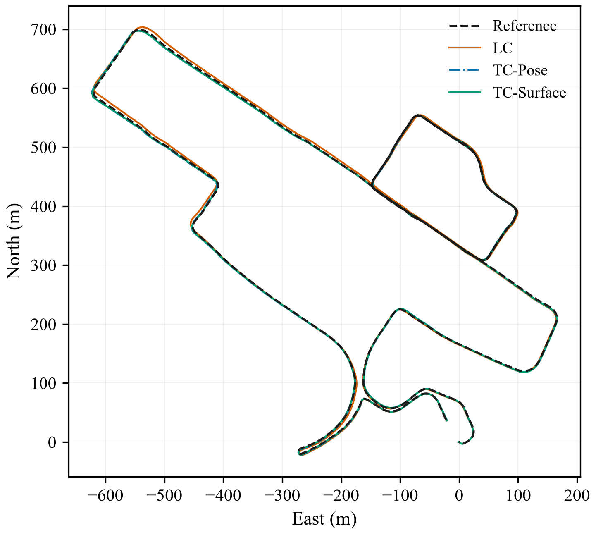
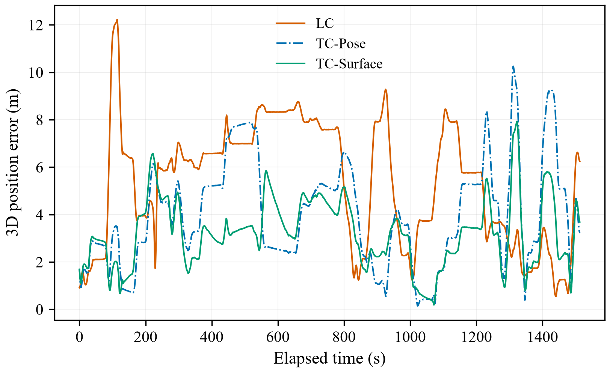

# GLIO fusion strategies on Deep-Urban-1

## Outcome

All three configurations completed the full prepared sequence under one frozen protocol.
Suitable for a clearly qualified textbook case study of these three GLIO-based configurations. This is a calibrated, controlled implementation case, not an exact
reproduction of the numerical results in the GLIO paper or a UAV flight test.

On these common epochs, TC-Surface had the lowest 3D RMSE
(3.508 m); TC-Surface had the lowest horizontal RMSE
(1.622 m). This describes one run per mode and supports
no statistical-significance or universal-superiority claim.

## Controlled conditions and necessary corrections

- Same verified compact bag: 614,782 original 400 Hz IMU messages and 15,355 center-LiDAR scans.
  One startup LiDAR scan preceding the first IMU was removed once for every mode. Original data are retained.
- Identical rover/base RINEX and ephemeris, DGNSS frontend (L1, forward), 1.0 replay rate,
  fixed feature-sampling seed 42, four logical CPUs, nice 10, and 24 GiB virtual-memory limit per process.
- Identical IMU/LiDAR extrinsics: identity rotation and [0, 0, 0.28] m translation.
  The published antenna translation [0, 0.86, -0.31] m is applied in the LC PVT correction
  and TC DD-pseudorange factor. The antenna translation is manually measured, with reported uncertainty about 0.1 m.
- Identical author-supplied anchor and roll/pitch/yaw prior: ECEF
  [-2419233.42, 5385473.13, 2405341.30] m and [0.6825, 0.098, 60.8] degrees.
  Its original derivation is unverified. No reference measurements enter online updates.
  Initial velocity and both IMU bias vectors are zero in the shared implementation.
- Author GLIO IMU-noise model values are held identical. They differ from the dataset's
  separate published Allan-calibration numbers and are declared shared model settings,
  not claimed to be newly identified sensor calibration.
- `RTKinLocal=true` is necessary: the upstream flag also gates the actual LC GNSS queue.
  Merely enabling `LCinLocal` with `RTKinLocal=false` does not supply LC GPS factors.
- The active DD factor originally hard-coded zero lever arm. The retained source patch
  adds the estimated-attitude antenna offset to the position-only residual. Its position
  Jacobians passed finite-difference checks (maximum observed discrepancy 3.05e-7).
  An adjacent estimated attitude selected by the repository's interpolation branch
  is frozen while that factor is assembled; rotational lever-arm Jacobians are not
  introduced. This is an approximation, not continuous attitude interpolation.
- The shared front end is LiDAR/IMU. LC uses gated DGNSS position factors; TC modes
  use raw DD L1 pseudorange in the batch graph. The upstream sliding-window GNSS
  and Doppler blocks remain disabled. The paper's broader architecture is not
  claimed to be fully activated by this experiment.
- Source commit `332d19ff641f2ada9d9d75f2a6dab013d6015f76`, exact changes in
  `source.patch`, input/config/binary hashes in `protocol.json`.
  The previous uncorrected TC-Surface run is archived and excluded from this comparison.

## Evaluation and common-epoch statistics

Eligible interval: UTC 1621578545 to 1621580060, after the
predeclared 20-second settling interval. The main table uses **1514 identical
1 Hz reference epochs**, UTC 1621578545 to 1621580058, with common coverage
99.87%. Interpolation is allowed only between estimated
samples no more than 1 second apart. All raw reference quality codes are retained.

Each estimated IMU pose is transferred to the SPAN-CPT point using its own estimated
attitude and the published [0, 0, 0.14] m body-to-SPAN translation. Reference attitude
is not used. Native CSV column 0 supplies Unix UTC; the LC GPS-week/seconds export
columns are not used for time alignment. There is no fitted rotation, translation,
scale or time shift.

| Method | Epochs | Horizontal RMSE (m) | Vertical RMSE (m) | 3D RMSE (m) | 3D P95 (m) | 3D maximum (m) | 10 s relative-displacement RMSE (m) |
|---|---:|---:|---:|---:|---:|---:|---:|
| LC | 1514 | 3.590 | 4.696 | 5.912 | 8.522 | 12.225 | 1.474 |
| TC-Pose | 1514 | 1.820 | 4.166 | 4.547 | 7.861 | 10.254 | 1.331 |
| TC-Surface | 1514 | 1.622 | 3.111 | 3.508 | 5.622 | 7.927 | 1.098 |

MAE and relative-displacement pair counts are also retained in `comparison_metrics.csv`.
The 10-second measure compares position displacements over matching epoch pairs;
it is not a full rotation-and-translation pose RPE.

| Method | Individually valid epochs | Coverage of eligible interval (%) | Accepted LC GNSS factors |
|---|---:|---:|---:|
| LC | 1514 | 99.87 | 14 |
| TC-Pose | 1514 | 99.87 | not applicable |
| TC-Surface | 1515 | 99.93 | not applicable |

The intersection does not replace the individual coverage table. LC retains its
published distance, covariance and uncertainty gates, so it does not use every
available GNSS position. Different observation forms and gating are part of the
three implementations; this is not an isolation of solver choice alone.

## Reference-quality groups

| Method | Raw quality code | Common epochs | Horizontal RMSE (m) | 3D RMSE (m) |
|---|---:|---:|---:|---:|
| LC | 1 | 500 | 2.532 | 5.403 |
| LC | 2 | 796 | 3.915 | 5.895 |
| LC | 3 | 103 | 4.321 | 6.135 |
| LC | 4 | 87 | 4.505 | 7.458 |
| LC | 5 | 28 | 3.903 | 8.317 |
| TC-Pose | 1 | 500 | 1.131 | 3.816 |
| TC-Pose | 2 | 796 | 2.005 | 5.006 |
| TC-Pose | 3 | 103 | 2.181 | 4.018 |
| TC-Pose | 4 | 87 | 2.509 | 4.849 |
| TC-Pose | 5 | 28 | 2.237 | 3.588 |
| TC-Surface | 1 | 500 | 0.983 | 3.122 |
| TC-Surface | 2 | 796 | 1.709 | 3.685 |
| TC-Surface | 3 | 103 | 1.946 | 3.077 |
| TC-Surface | 4 | 87 | 2.640 | 4.195 |
| TC-Surface | 5 | 28 | 2.529 | 3.985 |

These codes are reported as provided. No unverified centimetre-accuracy bound is
assigned to any code, and the reference is not assumed equally reliable everywhere.

## Resource observations

| Method | End-to-end wall time (s) | Final backend wait (s) | Sampled combined native RSS peak (MiB) | Sampled native CPU time (s) |
|---|---:|---:|---:|---:|
| LC | 1567.5 | 10.0 | 3547.2 | 1053.7 |
| TC-Pose | 1568.1 | 10.0 | 4275.4 | 2050.0 |
| TC-Surface | 1714.0 | 156.7 | 4651.5 | 2778.1 |

Wall time includes initialization, paced playback, final optimization and cleanup.
It is not pure solver processing time or proof of real-time capability. Native-node
RSS and CPU usage are sampled every 5 seconds; RSS sums shared pages across nodes
and is not a unique-memory or exact OS-peak measure. Runs are sequential, CPU-only,
and use the same private container. GPU and system configuration are unchanged.

## Figures

Each file is one standalone figure with English labels, Times New Roman, 300 dpi
PNG and vector PDF. All common-epoch samples are shown without error clipping.

## Use in the book

Place the main metrics table and the error-comparison figure after the GLIO
implementation discussion in Section 3.4.6. The trajectory overview is optional
if space is limited. Keep detailed quality/resource tables and the patch with
the accompanying experiment files. This illustrates position-level versus raw-GNSS
fusion, IMU/LiDAR constraints and batch nonlinear optimization. It does not replace
the independent B1-B3 filtering/optimization comparison or validate every algorithm
in Section 3.4 separately.

Suggested concise paragraph (reuse the existing GLIO [12] and UrbanNav [23] citations;
verify their numbering in the final manuscript):

> Three GLIO-based fusion configurations were evaluated on the Deep-Urban-1 ground-vehicle sequence of UrbanNav [12,23]. They used the same GNSS, LiDAR and IMU data, sensor extrinsics, supplied initialization prior, and feature-sampling seed. The public implementation was adjusted to activate the GNSS input of the LC branch and apply the published antenna lever arm. The shared front end used LiDAR/IMU, and the TC batch graph used double-difference pseudorange; Doppler factors were not enabled. The TC antenna offset was frozen at an adjacent estimated attitude during factor assembly. Position errors were evaluated at the SPAN-CPT reference point over 1514 common reference epochs, without fitted trajectory alignment. The horizontal RMSE values were 3.59, 1.82, 1.62 m for LC, TC-Pose and TC-Surface, respectively; the corresponding three-dimensional values were 5.91, 4.55, 3.51 m. These results illustrate the behavior of the three configurations under this shared setup. A single sequence and a supplied initial prior do not establish general superiority or UAV flight performance.

Suggested trajectory caption: Horizontal trajectories of three GLIO-based fusion
configurations on UrbanNav Deep-Urban-1, evaluated at the SPAN-CPT reference point.

Suggested error caption: Three-dimensional position errors against the provided
SPAN-CPT reference at common evaluation epochs on UrbanNav Deep-Urban-1.

The case is conditional on the documented supplied prior, public extrinsics,
position-only frozen-attitude lever approximation and reference quality. Single-run
results on one ground vehicle sequence cannot establish statistical generality,
paper-result reproduction, or performance on UAV flight data. Fixed sampling does
not eliminate asynchronous scheduling variation.

## Files and reproduction

`comparison_metrics.csv`, `reference_quality_metrics.csv`, `output_coverage.csv`,
`resource_summary.csv`, `evaluation_epochs.csv`, `comparison_results.json`,
`protocol.json`, `profile_manifest.json`, `source.patch`, and the two PNG/PDF pairs.
Native outputs remain once in the folders listed by `runs.json`; the dataset is
shared and not copied per method.

Run instructions and scripts: `/data/users/taslab_zxp/projects/GLIO_setup`.
The profile is `profiles/calibrated_v2`; use the same prepared input and replay
rate for every mode. Do not mix the archived author-v1/short-test results into
this common-epoch table.

Sources: [GLIO code](https://github.com/XikunLiu-huskit/GLIO),
[UrbanNav dataset](https://github.com/IPNL-POLYU/UrbanNavDataset),
[official Deep-Urban-1 extrinsics](https://github.com/IPNL-POLYU/UrbanNavDataset/blob/master/UrbanNav-HK-Deep-Urban-1/extrinsic.yaml).
